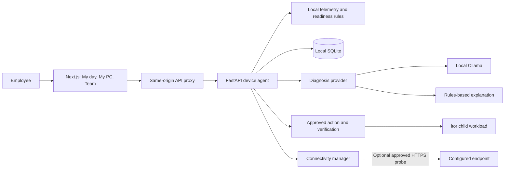

# Architecture

itor runs as two loopback services on the employee’s machine. Next.js serves the UI and bundled assets and passes approved API routes to FastAPI. FastAPI samples the host through psutil, owns the bounded child workload, and stores working time and compact events in SQLite. Ollama runs separately on loopback and receives a limited diagnosis payload.

## Time clock and offline help

`worktime.py` counts active, idle and lost time every 15 seconds and stores one total per day. `incidents.py` opens an outage log when internet or the cloud drops. `company.py` keeps an outbox of daily totals and outage logs and sends them to the company server (`ITOR_COMPANY_URL`) when online; the same program can act as that server and builds the team ranking. Diagnosis goes Claude (online) → local Ollama → rules. Quick fixes (`network_fixes.py`) and the demo workload stop run only after Approve.

## Provider boundaries

| Concern | Local implementation | Future integration |
| --- | --- | --- |
| Working time | Local time clock and company server | HR / payroll export |
| Telemetry | psutil snapshots and bounded in-memory history | Predefined tenant NQL queries with measurement timestamps |
| Diagnosis | Deterministic rules and optional loopback Ollama | Supported authenticated Spark handoff |
| Remediation | One allowlisted, agent-owned stop action | Configured Remote Actions or permitted workflows |
| Connectivity | Passive OS checks, independent status objects, optional HTTPS probe | Tenant-specific reachability and authentication adapter |

System CPU is a normalized all-core percentage. Child CPU is measured relative to one logical core. Sustained CPU rules use a configurable observation window and hysteresis. Audio and camera checks are manual. Default-route and resolver configuration checks use Linux and Unix system files where available and report their limits on other platforms. An approved HTTPS probe measures reachability to that endpoint.

## Offline operation

Next.js can render and serve static files with loopback alone. Browser-to-agent errors are reported separately from Internet, local Ollama, and Nexthink status. A failed HTTPS probe, a present interface, and an authentication failure have distinct meanings. The demo outage switch affects an adapter state only. An adapter can recover after stable successful checks without changing the local action history or regenerating approvals.

Nexthink remains unconfigured in the prototype. The optional synchronization boundary accepts minimal consented records and has no default cloud destination. See [NEXTHINK_INTEGRATION.md](NEXTHINK_INTEGRATION.md).

## Bundled artwork

The illustration is [hero-art.webp](../apps/web/public/hero-art.webp). It was created with the built-in image generation tool and compressed to WebP for offline delivery. The tool received this generation prompt.

> Create a wide landscape 3D decorative hero art background for the right half of the itor dashboard. In a near-black ink navy studio, a single large angled continuous orbital ring made of smoked dark violet glass and brushed chrome, with a fine electric-lavender edge reflection and two subtly luminous pinpoints on the orbit. Premium restrained industrial design render, sculptural and believable materials, crisp rim, subtle depth. Concentrate the object and all bright details in the rightmost two-thirds, letting the left third and exterior edges fade smoothly into uniform near-black navy, so a meeting title on the left stays readable. Wide crop with generous breathing space. No letters, text, logo, interface, instrument overlay, extra props or people.
